# Domain-model diagrams

[Back to dataset README](../README.md)

Rendered from the Mermaid gold standards. Click an image to open its SVG and zoom in. Class labels match the Classes workbook; association wording is reconciled using the [documented assumptions](../docs/model-assumptions.md). Nodes marked `associationOnly` have no matching gold-standard class. Every association and wording assumption is documented in `%%` comments in the linked Mermaid source; these comments are hidden in the SVG.

## Camperplus

[Mermaid source](../2_gold_standard_domain_models/camperplus.mmd) · [SVG image](camperplus.svg)

## Fish & Chips

[Mermaid source](../2_gold_standard_domain_models/fish_chips.mmd) · [SVG image](fish_chips.svg)

## Grocery

[Mermaid source](../2_gold_standard_domain_models/grocery.mmd) · [SVG image](grocery.svg)

## Planningpoker

[Mermaid source](../2_gold_standard_domain_models/planningpoker.mmd) · [SVG image](planningpoker.svg)

## Recycling

[Mermaid source](../2_gold_standard_domain_models/recycling.mmd) · [SVG image](recycling.svg)

## School

[Mermaid source](../2_gold_standard_domain_models/school.mmd) · [SVG image](school.svg)

## Sports

[Mermaid source](../2_gold_standard_domain_models/sports.mmd) · [SVG image](sports.svg)

## Supermarket

[Mermaid source](../2_gold_standard_domain_models/supermarket.mmd) · [SVG image](supermarket.svg)

## Ticket

[Mermaid source](../2_gold_standard_domain_models/ticket.mmd) · [SVG image](ticket.svg)

