# Domain-model diagrams

[Back to dataset README](../README.md)

Rendered from the Mermaid gold standards. Click an image to open its SVG and zoom in. Class labels match the revised `Gold&Silver Standard.xlsx` class list; association wording is reconciled using the [documented assumptions](../docs/model-assumptions.md). Optional classes are marked `«optional»` and optional associations are drawn as dashed lines; everything else is required. Every association and wording assumption is documented in `%%` comments in the linked Mermaid source; these comments are hidden in the SVG.

## Camperplus

[Mermaid source](../2_gold_standard_domain_models/camperplus.mmd) · [SVG image](camperplus.svg)

[](camperplus.svg)

## Fish & Chips

[Mermaid source](../2_gold_standard_domain_models/fish_chips.mmd) · [SVG image](fish_chips.svg)

[](fish_chips.svg)

## Grocery

[Mermaid source](../2_gold_standard_domain_models/grocery.mmd) · [SVG image](grocery.svg)

[](grocery.svg)

## Planningpoker

[Mermaid source](../2_gold_standard_domain_models/planningpoker.mmd) · [SVG image](planningpoker.svg)

[](planningpoker.svg)

## Recycling

[Mermaid source](../2_gold_standard_domain_models/recycling.mmd) · [SVG image](recycling.svg)

[](recycling.svg)

## School

[Mermaid source](../2_gold_standard_domain_models/school.mmd) · [SVG image](school.svg)

[](school.svg)

## Sports

[Mermaid source](../2_gold_standard_domain_models/sports.mmd) · [SVG image](sports.svg)

[](sports.svg)

## Supermarket

[Mermaid source](../2_gold_standard_domain_models/supermarket.mmd) · [SVG image](supermarket.svg)

[](supermarket.svg)

## Ticket

[Mermaid source](../2_gold_standard_domain_models/ticket.mmd) · [SVG image](ticket.svg)

[](ticket.svg)

## Additional projects

Expert class diagrams from two further appendices (addition, not part of Bragilovski et al. 2025). Inheritance is not drawn; it is listed in the `%%` comments. Sources, conversion rules and limits: [additional projects](../docs/additional-projects.md).

### Hospital, group 01

[Mermaid source](../2_gold_standard_domain_models/hospital_g01.mmd) · [User stories](../1_user_stories/hospital_g01.txt) · [SVG image](hospital_g01.svg)

[](hospital_g01.svg)

### Hospital, group 02

[Mermaid source](../2_gold_standard_domain_models/hospital_g02.mmd) · [User stories](../1_user_stories/hospital_g02.txt) · [SVG image](hospital_g02.svg)

[](hospital_g02.svg)

### Hospital, group 06

[Mermaid source](../2_gold_standard_domain_models/hospital_g06.mmd) · [User stories](../1_user_stories/hospital_g06.txt) · [SVG image](hospital_g06.svg)

[](hospital_g06.svg)

### Hospital, group 10

[Mermaid source](../2_gold_standard_domain_models/hospital_g10.mmd) · [User stories](../1_user_stories/hospital_g10.txt) · [SVG image](hospital_g10.svg)

[](hospital_g10.svg)

### Hospital, group 12

[Mermaid source](../2_gold_standard_domain_models/hospital_g12.mmd) · [User stories](../1_user_stories/hospital_g12.txt) · [SVG image](hospital_g12.svg)

[](hospital_g12.svg)

### Football portal, group 05

[Mermaid source](../2_gold_standard_domain_models/football_g05.mmd) · [User stories](../1_user_stories/football_g05.txt) · [SVG image](football_g05.svg)

[](football_g05.svg)

### Football portal, group 08

[Mermaid source](../2_gold_standard_domain_models/football_g08.mmd) · [User stories](../1_user_stories/football_g08.txt) · [SVG image](football_g08.svg)

[](football_g08.svg)

### Football portal, group 11

[Mermaid source](../2_gold_standard_domain_models/football_g11.mmd) · [User stories](../1_user_stories/football_g11.txt) · [SVG image](football_g11.svg)

[](football_g11.svg)

### Football portal, group 14

[Mermaid source](../2_gold_standard_domain_models/football_g14.mmd) · [User stories](../1_user_stories/football_g14.txt) · [SVG image](football_g14.svg)

[](football_g14.svg)

### Data Hub

[Mermaid source](../2_gold_standard_domain_models/datahub.mmd) · [User stories](../1_user_stories/datahub.txt) · [SVG image](datahub.svg)

[](datahub.svg)
